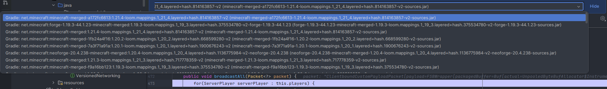

# Figura Server Backend, standalone

> [!caution]
> Before cloning the repository and importing it, **read the development information below.**
> Specifically, you need to read the _Sync performance & resources_ section.

## Development

### Working with FSB in a development environment

Making addons? Grab the parts of the mod you need from the table below.

> [!warning]
> **Warning: Snapshots**  
> Maven snapshot semantics demand that `-SNAPSHOT` is on the end, _after the `+` segment._
> You may have to adjust your build scripts to support this configuration, since doing `${fsbVersion}+fabric`
> does not work when `fsbVersion` is `1.2.3-SNAPSHOT` (it makes `1.2.3-SNAPSHOT+fabric`, which is wrong).  
> Or, just don't use snapshot versions :3

### Maven coordinates

This project exports quite a few maven coordinates (excluding sources, Javadoc):
Note that some code may only make it into `fat`-type jars, but that code is not part of the public API in any case.
(Currently, it only includes loggers.)

All artifacts are in the `org.figuramc.fsb` group, shortened to `[fsb]` in the table below.
Some artifacts are in subgroups.

| Group            |                   Artifact | Classifier  | Versioning       | Description                                                         |
|------------------|---------------------------:|:-----------:|------------------|:--------------------------------------------------------------------|
| `[fsb]`          |                 `:fsb-api` |             | `{version}`      | FSB's client/server shared API.                                     |
| `[fsb]`          |          `:fsb-server-api` |             | `{version}`      | FSB's server shared API.                                            |
| `[fsb].common`   | `:fsb-common-intermediary` |             | `{version}+{mc}` | Platform-independent code for targets supporting mixins.            |
| `[fsb].common`   | `:fsb-common-intermediary` |    `fat`    | `{version}+{mc}` | Platform-independent code for targets supporting mixins incl. deps. |
| `[fsb].common`   |       `:fsb-common-mojmap` |             | `{version}+{mc}` | `:fsb-common-intermediary` remapped to Mojang mappings.             |
| `[fsb].common`   |       `:fsb-common-mojmap` |    `fat`    | `{version}+{mc}` | `:fsb-common-intermediary:fat` remapped to Mojang mappings.         |
| `[fsb].fabric`   |              `:fsb-fabric` |             | `{version}+{mc}` | **Fabric fat jar for player and runtime use**                       |
| `[fsb].fabric`   |              `:fsb-fabric` | `component` | `{version}+{mc}` | Fabric slim jar for maven consumers                                 |
| `[fsb].forge`    |               `:fsb-forge` |             | `{version}+{mc}` | **Forge fat jar for player and runtime use**                        |
| `[fsb].forge`    |               `:fsb-forge` | `component` | `{version}+{mc}` | Forge slim jar for maven consumers                                  |
| `[fsb].neoforge` |            `:fsb-neoforge` |             | `{version}+{mc}` | **NeoForge fat jar for player and runtime use**                     |
| `[fsb].neoforge` |            `:fsb-neoforge` | `component` | `{version}+{mc}` | NeoForge slim jar for maven consumers                               |

### Development dependencies

You'll need at least 2 JDKs installed in places that Gradle can find them. We
like [Eclipse Adoptium Temurin ↗](https://adoptium.net/temurin/releases/), but feel free to use any distribution that
works.

1. a JDK 17, for building 1.16.5 until
   1.20.4. [Download Temurin JDK 17 ↗](https://adoptium.net/temurin/releases?version=17&os=any&arch=any)
2. a JDK 21, for building 1.20.6 until
   1.21.4. [Download Temurin JDK 21 ↗](https://adoptium.net/temurin/releases?version=21&os=any&arch=any)
3. you may need a JDK 25 in the future, but it is **not necessary for now**

You need to assign **JDK 21 (or newer) as your `JAVA_HOME`**. How to do this temporarily varies by operating system.

- If you're running the project in IntelliJ IDEA, which JDK is used in the integrated terminal is determined by the
  Project SDK, located in **(top menu) File → Project Structure → Project (tab) → SDK**.
    - You may have to terminate the terminal and re-open it for changes to apply.
- On Linux and macOS (most -sh shells), you can use `JAVA_HOME=/path/to/jdk/21 ./gradlew`, or
  `export JAVA_HOME=/path/to/jdk/21` to keep the preference for your session
- On Windows PowerShell, you can use `$env:JAVA_HOME=\path\to\jdk\21` to set the variable for your session.

### Sync performance & resources

This project has a _LOT_ of dependencies. By default, you'll need around 7 gigabytes of disk space for cache (yes,
really!!)

> [!important]
> ### How to Not use 7 GB for cache (filtered builds)
> We have a mechanism to avoid configuring the projects you aren't working with.
> This can save you a LOT of time and disk space!
>
> 1. Create a file named `build.properties` in the project root, preferably **before** opening
     > the project in IDEA.
> 2. Add the following contents, adjusting the parameters as necessary:
> ```properties
> # Filtered build options
> 
> # "Fabric", "Forge", "NeoForge" are supported platforms. Separate with commas.
> platforms=Fabric,Forge,NeoForge
> 
> # Separate Minecraft versions with commas.
> #minecraft=1.16.5,1.18.2,1.19.2,1.19.3,1.19.4,1.20.1,1.20.2,1.20.4,1.20.6,1.21.1,1.21.3,1.21.4
> minecraft=1.20.1,1.21.1,1.21.4
> ```
> 3. Run `./gradlew`. Watch carefully for the start of the output and get ready to cancel it with `Ctrl` `C` if
     something's wrong.
>
> This is also important when debugging in order to avoid this:
>
> 

The main culprit for the massive cache size is the fact that you're downloading at least 30 copies of Minecraft in
various forms.

The initial sync might take a long time due to all the downloading that needs to happen. Subsequent Gradle operations
should be significantly quicker, especially if you keep using the same Gradle daemon throughout.

Some statistics that may help you decide what to do (and whether you want to use filtered builds):

* This project has CI. The CI process caches only the global Gradle cache (`~/.gradle`).
    * Running an unfiltered build from no cache takes upwards of **30 minutes** (!)
    * With the cache loaded (but not including the project cache), a build takes **5 minutes**
* On my personal computer (which is pretty powerful to be fair), I can run a full unfiltered build in **50 seconds**
  with the
  global and project cache primed (`gradlew clean build --rerun-tasks`)

### Running the game

This project **does not create run configurations for you**. There would be 60 of them and you'd probably lose a bunch
of time clicking the wrong configurations.

Also, the run configurations wouldn't work anyway due to this project's resource processing system. Instead, to run the
game, use the `runClient` or `runServer` tasks in conjunction with the `-PoverrideMC=<mc version>`
command line flag. For example, to run a 1.20.1 Fabric Dedicated Server, it would be

```sh
./gradlew -PoverrideMC=1.20.1 :minecraft:fabric:1.20.1:runServer
```

(psst: you should learn shorthand for the tasks you use frequently. for example that's
`./gradlew -PoverrideMC=1.20.1 :m:fab:1.20.1:ruS` :P)

Not providing `overrideMC` will result in broken dependency info in the built mod, which will cause mod loading to
inevitably fail.

> [!note]
> If any Gradle witches/wizards/sorcerers want to help out and make this situation less bad, we need to somehow
transform the resources from a common module according to which module is depending on the common module.
>
> We're accomplishing this in release builds for now by transforming the final product in `shadowJar`.
> If there were a way to transform the incoming resources before that on the dependent project's side
> before it gets sent to the classpath, that would be perfect!

